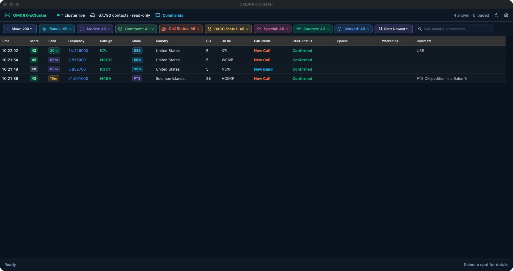

# OM0RX-xCluster

[](#requirements)
[](LICENSE)

A native macOS DX-cluster client for **Oliver Bross OM0RX**. It connects to one or more clusters, classifies live spots from OM0RX-xLog or a selected RUMlogNG logbook, shows full previous-QSO evidence, and hands a selected spot to OM0RX-xLog or RUMlogNG for station tuning.



## Highlights

- Simultaneous, auto-reconnecting telnet connections; `cluster.shackcq.com:7300` is included by default.
- Built-in cluster command console with one/all-cluster targeting, useful read-only presets, custom commands, and copyable replies.
- RBN/Skimmer requests are enabled by default with `set/skimmer`, and RBN spots can be filtered independently.
- Dense live spot table with call, frequency, mode, country, CQ zone, call status, DXCC status, special tags, exact worked-before date, score, source, spotter, and comment.
- One-row, color-coded multi-select filters for bands, modes, continents, call/DXCC status, specials, source, and worked-before state, plus free text and sorting. Each selector supports one, several, or all values.
- OM0RX call/DXCC status rules plus independently configurable colours for
  statuses, every amateur band, and every supported mode.
- Configurable, human-readable multi-match special-station rules (POTA, SOTA, IOTA, WWFF, bunkers, castles, lighthouses, contests, and IARU by default), with optional expert patterns.
- Direct OM0RX-xLog and `.rlog` access using SQLite `READONLY` plus `PRAGMA query_only=ON`; the app never writes to either database.
- Previous-QSO sheet with callsign history, independently colored LoTW upload/download arrows, DXCC/grid summary, and a country-wide DXCC band/mode matrix (orange worked, green confirmed, dash untouched).
- One-click OM0RX-xLog handoff from every row area except the callsign, which opens Previous QSOs. RUMlogNG remains a selectable compatibility target.
- Optional OM0RX-xCat/RigCtlD mode handoff on `127.0.0.1:14532`, so the radio changes mode as well as frequency.
- Exact callsign/band/mode combinations already worked are hidden by default; a setting restores them without hiding new-band or new-mode opportunities.
- Cluster passwords stored in macOS Keychain.

## Build

```bash
swift test
./scripts/make-icon.sh
./scripts/package-app.sh
```

The packaged app is written to `dist/OM0RX-xCluster.app`. The packaging script uses an available Developer ID Application identity, otherwise it creates an ad-hoc signed development build.

## First run

1. Open Settings → General and choose OM0RX-xLog (default) or a RUMlogNG `.rlog` as the classification source.
2. In Settings → Clusters, confirm your login callsign and enable the desired servers.
3. Save and apply. The status rail will show both live cluster count and contact count.
4. In Settings → Colours, adjust the Call/DXCC, Band, or Mode palettes if desired.
5. Click a callsign to inspect previous QSOs. Click elsewhere on its row to open the spot in OM0RX-xLog.
6. If RUMlogNG is selected instead, approve the macOS Automation request on first tune.

## Safety boundaries

- Logbook access is read-only. OM0RX-xLog owns its local log and Wavelog synchronization; OM0RX-xBridge remains available for RUMlog compatibility.
- Clicking a data cell outside the callsign intentionally tunes the selected spot; clicking the callsign only opens history.
- Live cluster authentication, RF tuning, and rotor motion depend on the operator's network, RUMlogNG configuration, radio, and rotator. Local tests cannot prove those external paths.

## Requirements

- macOS 13 or newer
- OM0RX-xLog for the integrated logging workflow, or RUMlogNG for compatibility
- A local OM0RX-xLog database or RUMlog `.rlog` for worked/confirmed classification

## License

GNU General Public License v3.0. See [LICENSE](LICENSE).
